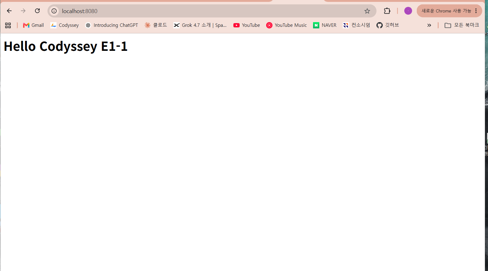
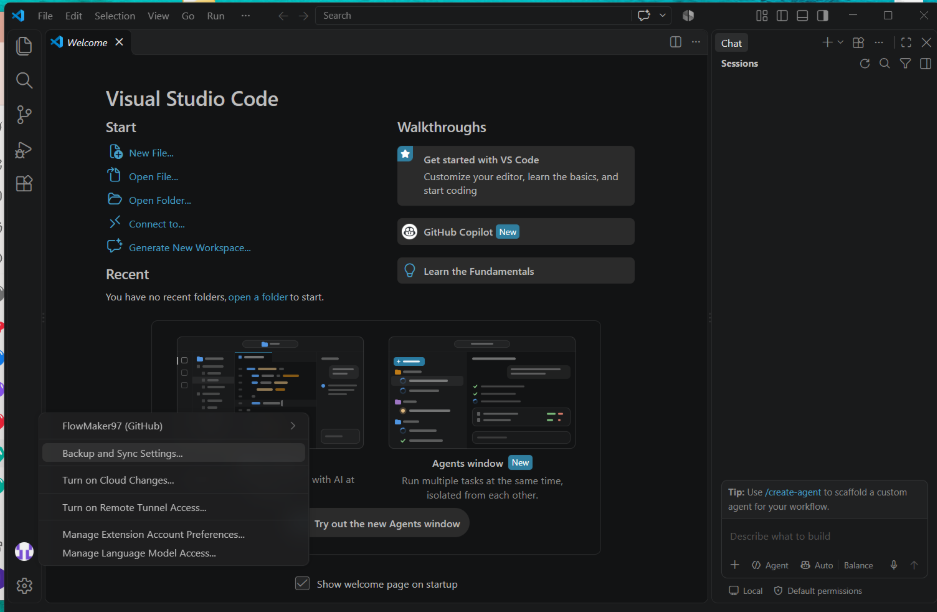
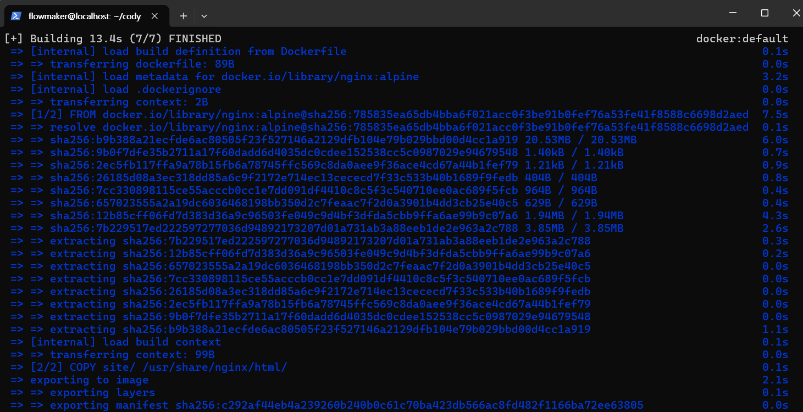
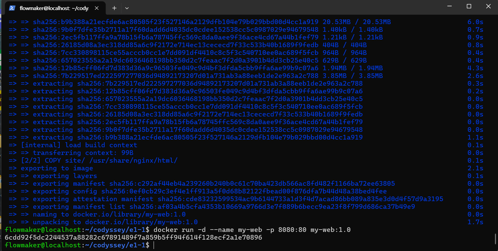
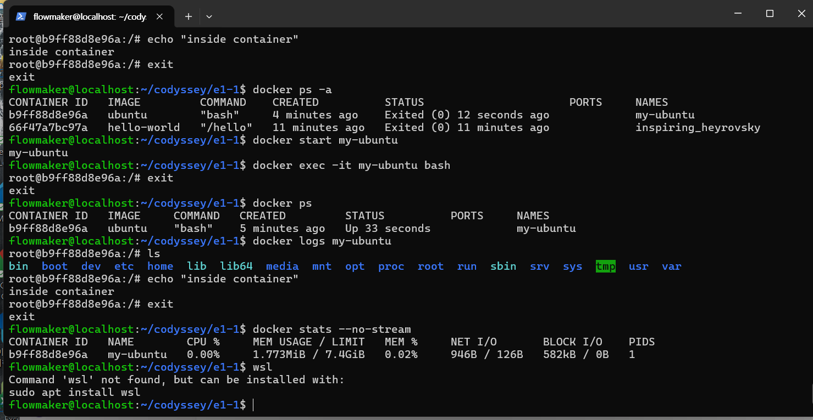

# Codyssey E1-1: 개발자 작업실 꾸미기

리눅스 터미널, 권한, Docker, Git/GitHub로 개발 환경을 직접 구축하고 검증한 기록입니다.
명령어, 실행 결과, 개념 설명을 함께 기록했습니다. 아래 재검증 출력은 2026-11-07 기존 WSL 환경에서 수집했으며, 과거 스크린샷과 실행 시점이 달라 컨테이너 상태·시간·이미지 ID가 다를 수 있습니다.

## 1. 실행 환경

| 항목 | 내용 |
|---|---|
| OS | Windows 11 + WSL2 Ubuntu |
| Shell | bash |
| Docker | Docker version 29.9.2, build a82e528 |
| Git | git version 2.53.0 |
| 작업 경로 | `~/codyssey/e1-1` |

## 2. 체크리스트

- [x] 터미널 기본 명령 (pwd, ls -la, cd, mkdir, cp, mv, rm, cat, touch)
- [x] 권한 실습 (파일 1개, 디렉토리 1개 변경 전후)
- [x] Docker 설치 및 점검 (`--version`, `info`)
- [x] hello-world 실행
- [x] ubuntu 컨테이너 실행, exec, logs, stats
- [x] Dockerfile로 커스텀 이미지 만들기
- [x] 포트 매핑 후 브라우저 접속
- [x] 바인드 마운트 변경 전후 확인
- [x] 볼륨 데이터 유지 확인
- [x] Git 설정 (user.name, user.email, 기본 브랜치)
- [x] VS Code GitHub 로그인 증거

## 3. 터미널 기본 조작

```bash
pwd
mkdir -p ~/codyssey/e1-1
cd ~/codyssey/e1-1
touch hello.txt
echo "hello codyssey" > hello.txt
cat hello.txt
cp hello.txt hello_copy.txt
mv hello_copy.txt hello_moved.txt
rm hello_moved.txt
ls -la
```

## 4. 권한 실습

권한은 r(읽기)=4, w(쓰기)=2, x(실행)=1을 더한 숫자로 표현합니다. 세 자리는 각각 소유자, 그룹, 기타 사용자입니다.

```bash
# 파일: 644(rw-r--r--) → 600(rw-------)
ls -l hello.txt
chmod 600 hello.txt
ls -l hello.txt

# 디렉토리: 755(rwxr-xr-x) → 700(rwx------)
mkdir perm_dir
ls -ld perm_dir
chmod 700 perm_dir
ls -ld perm_dir
```

변경 후에는 소유자만 파일과 디렉토리에 접근할 수 있습니다.

## 5. Docker 설치 및 점검

```bash
docker --version
docker info
docker run hello-world
docker images
```

## 6. 컨테이너 실행과 관리

```bash
docker run -it --name my-ubuntu ubuntu bash
# 컨테이너 안에서
ls
echo "inside container"
exit

docker ps -a              # exit 후 Exited 상태
docker start my-ubuntu
docker exec -it my-ubuntu bash
exit
docker ps                 # exec에서 나와도 Up 상태 유지
docker logs my-ubuntu
docker stats --no-stream
```

**attach와 exec의 차이**
- `run -it`/`attach`는 컨테이너의 메인 프로세스(bash)에 붙습니다. 여기서 `exit`하면 메인 프로세스가 끝나서 컨테이너도 멈춥니다.
- `exec`는 이미 실행 중인 컨테이너 안에 새 프로세스를 하나 더 띄웁니다. 그래서 `exit`해도 컨테이너는 계속 실행됩니다.

## 7. Dockerfile로 커스텀 웹 서버 만들기

```
site/index.html
Dockerfile
```

```dockerfile
FROM nginx:alpine
COPY site/ /usr/share/nginx/html/
```

| 줄 | 목적 |
|---|---|
| `FROM nginx:alpine` | 가벼운 nginx 웹서버 이미지를 기반으로 사용 |
| `COPY site/ /usr/share/nginx/html/` | 직접 만든 페이지를 nginx가 서비스하는 폴더에 복사 |

```bash
docker build -t my-web:1.0 .
docker run -d --name my-web -p 8080:80 my-web:1.0
```

## 8. 포트 매핑

`-p 8080:80`은 내 컴퓨터 8080번 포트로 들어온 요청을 컨테이너 안 80번 포트(nginx)로 연결한다는 뜻입니다.
브라우저에서 `http://localhost:8080`에 접속해 `Hello Codyssey E1-1`이 표시되는 것을 확인했습니다.



## 9. 바인드 마운트

```bash
docker run -d --name my-web-bind -p 8081:80 \
  -v $(pwd)/site:/usr/share/nginx/html nginx:alpine
curl localhost:8081
# <h1>Hello Codyssey E1-1</h1>

echo '<h1>Bind mount changed!</h1>' > site/index.html
curl localhost:8081
# <h1>Bind mount changed!</h1>
```

호스트 폴더와 컨테이너 폴더를 연결했기 때문에, 이미지를 다시 빌드하지 않아도 호스트에서 바꾼 내용이 바로 반영됩니다.

## 10. 볼륨 데이터 유지

```bash
docker volume create mydata
docker run --name vol-test -v mydata:/data ubuntu bash -c "echo 'hello volume' > /data/test.txt"
docker rm vol-test
docker run --rm -v mydata:/data ubuntu cat /data/test.txt
# hello volume
docker volume ls
```

컨테이너를 삭제해도 볼륨에 저장된 데이터는 남아 있습니다.

## 11. Git 설정과 GitHub 연동

```bash
git config --global user.name "flowmaker97"
git config --global user.email "<본인의 GitHub 등록 이메일>"  # 공개 문서에서는 마스킹
git config --global init.defaultBranch main
git config --list
# user.name=flowmaker97
# user.email=****@gmail.com
# init.defaultbranch=main

git init
git add .
git commit -m "E1-1 docker web, bind mount, volume"
git remote add origin https://github.com/FlowMaker97/codyssey-e1-1.git
git push -u origin main
```

푸시 때는 비밀번호 대신 GitHub Personal Access Token을 사용했습니다. 토큰은 공개하지 않습니다.

## 12. 트러블슈팅

### 사례 1. mv 대상 파일이 없음
- **문제**: `mv hello_copy.txt ...` 실행 시 `No such file or directory`
- **가설**: 옮길 파일이 아직 만들어지지 않았다.
- **확인**: `ls -la`로 보니 `hello_copy.txt`가 없었다. 앞의 `cp` 명령을 건너뛴 상태였다.
- **해결**: `cp hello.txt hello_copy.txt`를 먼저 실행한 뒤 `mv`를 다시 실행했다.

### 사례 2. sudo 비밀번호를 잊음
- **문제**: `sudo` 실행 시 인증 실패가 반복됐다.
- **가설**: WSL 사용자 비밀번호를 잘못 기억하고 있다.
- **확인**: 여러 번 시도해도 실패했다.
- **해결**: PowerShell에서 `wsl -u root`로 root 접속 후 `passwd flowmaker`로 비밀번호를 재설정했다.

### 사례 3. 명령어 두 줄이 한 줄로 합쳐짐
- **문제**: `executable file not found: bashdocker` 오류
- **가설**: 붙여넣은 두 명령어 사이 줄바꿈이 빠졌다.
- **확인**: 명령어가 `... ubuntu bashdocker run ...`처럼 이어져 있었다. 이어서 `exit`로 WSL 밖으로 나가 PowerShell에서 `docker`를 찾지 못하는 문제도 생겼다.
- **해결**: `wsl`로 다시 들어가 `cd ~/codyssey/e1-1`, `docker rm my-ubuntu` 후 한 줄씩 다시 실행했다.

## 13. 증거 자료

`screenshots/` 폴더에 실행 화면을 모았습니다. 이메일과 토큰 같은 민감 정보는 가렸습니다.

## 14. VS Code GitHub 연동
VS Code에서 GitHub 계정(FlowMaker97)으로 로그인 완료.



## 15. 파일과 폴더의 역할

| 경로 | 역할 |
|---|---|
| `README.md` | 실습 명령, 실제 출력, 개념과 문제 해결 기록 |
| `Dockerfile` | nginx 기반 이미지에 `site/` 내용을 복사하는 빌드 지시서 |
| `site/index.html` | nginx가 브라우저에 제공하는 HTML 페이지. 바인드 마운트 실습에서도 수정하는 파일 |
| `hello.txt` | 터미널의 생성·내용 확인·복사·이동 및 파일 권한 실습 대상 |
| `memo.txt` | `touch`로 만든 빈 메모 파일 |
| `perm_dir/` | 디렉토리 접근 권한 실습 대상. 빈 디렉토리는 Git이 추적하지 않아 저장소에는 없음 |
| `screenshots/` | 기존 실행 화면과 브라우저·VS Code 연동 증거 |
| `.git/` | 로컬 Git 이력, 브랜치, 원격 설정을 관리하는 숨김 디렉토리 |

이미지는 파일 시스템과 실행 설정을 묶은 읽기 전용 템플릿입니다. 컨테이너는 이미지에서 생성한 실행 인스턴스이며 자체 쓰기 계층과 프로세스 상태를 가집니다. 같은 이미지로 여러 컨테이너를 만들 수 있습니다. `docker images`는 이미지 목록, `docker ps`는 실행 중인 컨테이너, `docker ps -a`는 종료된 컨테이너까지 보여줍니다. 컨테이너를 삭제하면 자체 쓰기 계층의 데이터도 사라지므로 보관할 데이터는 마운트에 저장합니다.

## 16. 실제 터미널 출력 (2026-11-07 WSL 재검증)

다음은 `/home/flowmaker/codyssey/e1-1`의 실습 환경에서 직접 수집한 출력입니다. 시간·ID·컨테이너 상태는 과거 스크린샷과 다를 수 있습니다. 이메일은 공개 문서에서 마스킹합니다.

### touch/chmod 전후

기존 파일을 보존하기 위해 별도 임시 디렉토리에서 실행했습니다. `touch`, `mkdir`, `chmod`는 성공 시 출력이 없습니다. 처음 오류는 파일이 아직 없다는 확인 결과입니다.

```console
$ umask 022; ls -l hello.txt; touch hello.txt; ls -l hello.txt; chmod 600 hello.txt; ls -l hello.txt; mkdir perm_dir; ls -ld perm_dir; chmod 700 perm_dir; ls -ld perm_dir
ls: cannot access 'hello.txt': No such file or directory
-rw-r--r-- 1 flowmaker flowmaker 0 Nov  7 17:41 hello.txt
-rw------- 1 flowmaker flowmaker 0 Nov  7 17:41 hello.txt
drwxr-xr-x 2 flowmaker flowmaker 40 Nov  7 17:41 perm_dir
drwx------ 2 flowmaker flowmaker 40 Nov  7 17:41 perm_dir
```

파일의 `644`는 소유자 읽기·쓰기, 그룹과 기타 사용자 읽기 권한이고 `600`은 소유자 읽기·쓰기만 허용합니다. 디렉토리의 `r`은 목록 읽기, `w`는 항목 생성·삭제, `x`는 경로 진입·탐색입니다. `755`에서 `700`으로 바꾸면 소유자만 이 권한을 가집니다.

### Docker daemon 상태

```console
$ docker info
Client: Docker Engine - Community
 Version:    29.9.2
 Context:    default
 Debug Mode: false
 Plugins:
  buildx: Docker Buildx (Docker Inc.)
    Version:  v0.38.1
    Path:     /usr/libexec/docker/cli-plugins/docker-buildx
  compose: Docker Compose (Docker Inc.)
    Version:  v5.6.1
    Path:     /usr/libexec/docker/cli-plugins/docker-compose
  model: Docker Model Runner (Docker Inc.)
    Version:  v1.2.9
    Path:     /usr/libexec/docker/cli-plugins/docker-model

Server:
 Containers: 5
  Running: 0
  Paused: 0
  Stopped: 5
 Images: 4
 Server Version: 29.9.2
 Storage Driver: overlayfs
  driver-type: io.containerd.snapshotter.v1
 Logging Driver: json-file
 Cgroup Driver: systemd
 Cgroup Version: 2
 Plugins:
  Volume: local
  Network: bridge host ipvlan macvlan null overlay
  Log: awslogs fluentd gcplogs gelf journald json-file local splunk syslog
 CDI spec directories:
  /etc/cdi
  /var/run/cdi
 Swarm: inactive
 Runtimes: io.containerd.runc.v2 runc
 Default Runtime: runc
 Init Binary: docker-init
 containerd version: b7a25261e029d68978bbf290df0a62fc819b3c51
 runc version: v1.5.2-0-g29dd3dc2
 init version: de40ad0
 Security Options:
  seccomp
   Profile: builtin
  cgroupns
 Kernel Version: 6.18.54.1-microsoft-standard-WSL2
 Operating System: Ubuntu 26.04.1 LTS
 OSType: linux
 Architecture: x86_64
 CPUs: 8
 Total Memory: 7.4GiB
 Name: localhost
 ID: 02611450-a2f3-4017-87d7-1748210f9aaf
 Docker Root Dir: /var/lib/docker
 Debug Mode: false
 Experimental: false
 Insecure Registries:
  127.0.0.0/8
  ::1/128
 Live Restore Enabled: false
 Firewall Backend: iptables
  EnableUserlandProxy: true
  UserlandProxyPath: /usr/bin/docker-proxy
```

### hello-world 실행

```console
$ docker run hello-world

Hello from Docker!
This message shows that your installation appears to be working correctly.

To generate this message, Docker took the following steps:
 1. The Docker client contacted the Docker daemon.
 2. The Docker daemon pulled the "hello-world" image from the Docker Hub.
    (amd64)
 3. The Docker daemon created a new container from that image which runs the
    executable that produces the output you are currently reading.
 4. The Docker daemon streamed that output to the Docker client, which sent it
    to your terminal.

To try something more ambitious, you can run an Ubuntu container with:
 $ docker run -it ubuntu bash

Share images, automate workflows, and more with a free Docker ID:
 https://hub.docker.com/

For more examples and ideas, visit:
 https://docs.docker.com/get-started/
```

### 컨테이너 목록

```console
$ docker ps -a
CONTAINER ID   IMAGE          COMMAND                  CREATED          STATUS                              PORTS     NAMES
817723fcac86   hello-world    "/hello"                 1 second ago     Exited (0) Less than a second ago             romantic_dirac
aebd38dc862d   hello-world    "/hello"                 44 seconds ago   Exited (0) 43 seconds ago                     friendly_fermi
de29c49cbdc3   nginx:alpine   "/docker-entrypoint.…"   4 days ago       Exited (0) 4 days ago                         my-web-bind
6cdd92f5dc22   af03a4b5cfa4   "/docker-entrypoint.…"   4 days ago       Exited (0) 4 days ago                         my-web
b9ff88d8e96a   ubuntu         "bash"                   7 days ago       Exited (255) 4 days ago                       my-ubuntu
66f47a7bc97a   hello-world    "/hello"                 7 days ago       Exited (0) 7 days ago                         inspiring_heyrovsky
```

### 이미지 목록 (재빌드 전)

```console
$ docker images
IMAGE                ID             DISK USAGE   CONTENT SIZE   EXTRA
hello-world:latest   c567b231f656       25.9kB         9.49kB   U
my-web:1.0           86701856128b       93.6MB         26.3MB
nginx:alpine         785835ea65db       94.5MB         27.2MB   U
ubuntu:latest        6a06111c3b0a        163MB         45.9MB   U
```

### Docker build 로그

```console
$ docker build --progress=plain -t my-web:1.0 .
#0 building with "default" instance using docker driver

#1 [internal] load build definition from Dockerfile
#1 transferring dockerfile: 89B 0.0s done
#1 DONE 0.0s

#2 [internal] load metadata for docker.io/library/nginx:alpine
#2 DONE 0.0s

#3 [internal] load .dockerignore
#3 transferring context: 2B done
#3 DONE 0.0s

#4 [internal] load build context
#4 transferring context: 60B done
#4 DONE 0.0s

#5 [1/2] FROM docker.io/library/nginx:alpine@sha256:785835ea65db4bba6f021acc0f3be91b0fef76a53fe41f8588c6698d2aed0606
#5 resolve docker.io/library/nginx:alpine@sha256:785835ea65db4bba6f021acc0f3be91b0fef76a53fe41f8588c6698d2aed0606 0.0s done
#5 DONE 0.0s

#6 [2/2] COPY site/ /usr/share/nginx/html/
#6 CACHED

#7 exporting to image
#7 exporting layers done
#7 exporting manifest sha256:7dd516a48c509f143bd4059a8072e75c52c2c95a81cfea7e0bd6ecd30b8681c7 done
#7 exporting config sha256:30455204a63d83223b4eaae3b5d6a0995b48125cf8d15cd214cd85ce59e13fe3 done
#7 exporting attestation manifest sha256:514dfdadecf9b6c36355356d06573c0659ac86d44d6510179c19f65d1cb473f4
#7 exporting attestation manifest sha256:514dfdadecf9b6c36355356d06573c0659ac86d44d6510179c19f65d1cb473f4 0.0s done
#7 exporting manifest list sha256:4a66a5ed001dfa07a030acb922e8a94e1a8feb66f71f90f22121980116c5c5ef 0.0s done
#7 naming to docker.io/library/my-web:1.0 done
#7 unpacking to docker.io/library/my-web:1.0 0.0s done
#7 DONE 0.2s
```

### Git remote

```console
$ git remote -v
origin	https://github.com/FlowMaker97/codyssey-e1-1.git (fetch)
origin	https://github.com/FlowMaker97/codyssey-e1-1.git (push)
```

`docker info`의 Server 응답은 daemon에 연결되었다는 근거입니다. hello-world는 메시지를 출력하고 정상 종료하므로 `Exited (0)`가 정상입니다. 목록의 다른 종료 코드만으로 과거 원인을 단정하지 않습니다. 빌드의 `CACHED`는 기존 레이어 재사용이고, 마지막 이미지 이름 지정 및 `DONE`은 빌드 완료를 나타냅니다. `-t my-web:1.0`은 이미지 이름·태그, 마지막 `.`은 현재 폴더를 빌드 컨텍스트로 지정합니다.

### Git push 성공 로그

**재현하지 못함.** 과거 push 성공 터미널 로그가 저장소 자료에 없으며, 이번에는 사용자의 요청에 따라 push를 실행하지 않았습니다. remote의 `(push)` 표시는 push 대상 URL이며 실제 전송 성공 로그가 아닙니다. 전송 객체 수·속도·성공 문구를 만들어 넣지 않았습니다.

### 웹 파일 실제 내용

```console
$ cat site/index.html
<h1>Bind mount changed!</h1>
$ cat Dockerfile
FROM nginx:alpine
COPY site/ /usr/share/nginx/html/
```

`site/index.html`은 nginx가 응답할 페이지입니다. 현재 내용은 바인드 마운트 실습에서 변경한 `Bind mount changed!`이며 과거 브라우저 스크린샷의 초기 문구와 다릅니다. `Dockerfile`의 `FROM`은 기반 이미지를 지정하고 `COPY`는 빌드 시점의 `site/`를 웹 루트로 복사합니다.





## 17. 포트와 저장소 개념 보충

### `-p 8080:80`의 의미와 포트 충돌 해결

왼쪽 `8080`은 Docker 호스트 포트이고 오른쪽 `80`은 컨테이너 안 nginx의 TCP 포트입니다. `http://localhost:8080` 요청이 컨테이너의 80번으로 전달됩니다. 컨테이너마다 독립된 네트워크가 있어 내부 80번을 함께 쓸 수 있지만, 같은 호스트 IP의 8080번 포트는 중복 점유할 수 없습니다. 호스트 IP를 생략하면 기본적으로 모든 호스트 주소에 게시됩니다. 로컬 접속만 필요하면 `-p 127.0.0.1:8080:80`을 사용합니다.

`address already in use` 또는 `port is already allocated`가 나오면 다음 명령으로 **Docker 호스트의** 점유자를 확인합니다. 아래는 해결 절차이며 이번에 실제 충돌을 발생시킨 로그는 아닙니다.

```bash
sudo ss -ltnp 'sport = :8080'
# 또는 LISTEN 소켓의 프로세스 확인
sudo lsof -nP -iTCP:8080 -sTCP:LISTEN
# net-tools가 설치된 환경의 대안
sudo netstat -ltnp | grep ":8080 "
docker ps --filter publish=8080
```

확인한 PID의 명령을 `ps -p <PID> -o pid,user,args`로 살펴보고, 종료해도 되는 본인 프로세스라면 `kill -TERM <PID>`로 정상 종료합니다. `<PID>`는 실제 조회한 숫자로 바꿉니다. Docker 컨테이너가 점유한다면 프록시 PID를 직접 죽이는 대신 `docker stop <컨테이너 이름>`으로 중지합니다. 이어서 `ss` 또는 `lsof`를 다시 실행해 포트가 비었는지 확인합니다. 서비스를 유지해야 한다면 기존 프로세스를 종료하지 않고 새 컨테이너에 `-p 8082:80`처럼 다른 호스트 포트를 지정합니다.

WSL 조회 결과가 비어도 충돌한다면 Windows 측 점유 여부를 PowerShell의 `Get-NetTCPConnection -LocalPort 8080 -State Listen`과 `Get-Process -Id <OwningProcess>`로 확인합니다.

### 바인드 마운트와 볼륨 비교

| 구분 | 바인드 마운트 | 이름 있는 볼륨 |
|---|---|---|
| 예시 | `-v "$(pwd)/site:/usr/share/nginx/html"` | `-v mydata:/data` |
| 원본 위치 | 사용자가 지정한 호스트 경로 | Docker가 관리하는 저장소 |
| 용도 | 호스트 편집 파일을 컨테이너와 공유 | DB 등 지속적으로 보관할 데이터 |
| 변경 반영 | 호스트 파일 수정이 연결된 컨테이너에 반영 | 볼륨을 마운트한 컨테이너에서 데이터 읽기·쓰기 |
| 컨테이너 삭제 후 | 호스트 파일 유지 | 볼륨을 별도로 삭제하지 않으면 데이터 유지 |

`COPY`는 빌드 시점의 파일을 이미지에 넣으므로 이후 호스트 파일 수정에는 재빌드가 필요합니다. 바인드 마운트는 실행 시점의 경로 연결이므로 재빌드 없이 수정이 반영됩니다. 이 실습에서는 마운트 대상의 기존 이미지 파일이 마운트된 폴더에 가려집니다. 볼륨 실습은 `vol-test`를 삭제한 뒤 다른 컨테이너에서 같은 `mydata`를 마운트해 `hello volume`을 읽어 지속성을 확인했습니다. 볼륨 삭제 명령까지 실행하면 데이터가 사라질 수 있으므로 컨테이너 삭제와 구별해야 합니다.

개념 참고: [Docker 저장소 공식 문서](https://docs.docker.com/engine/storage/), [포트 게시 공식 문서](https://docs.docker.com/engine/network/port-publishing/).

### 포트 점유 조회의 실제 재검증

아래는 현재 환경에서 실행한 조회입니다. 빈 결과는 해당 조회에서 LISTEN 점유자를 찾지 못했다는 의미입니다. 실제 충돌 상황과 프로세스 종료는 **재현하지 못함**: 기존 서비스를 임의로 종료하지 않았습니다. 위 `kill -TERM <PID>`와 `docker stop <컨테이너 이름>`은 점유자를 확인한 뒤 적용할 해결 절차입니다.

```console
$ lsof -nP -iTCP:8080 -sTCP:LISTEN
(출력 없음)
```

```console
$ netstat -ltnp
/bin/sh: 1: netstat: not found
```

이 환경에서는 netstat을 사용할 수 없어 netstat 조회는 **재현하지 못함**입니다. 설치된 `lsof` 또는 앞의 `ss` 명령을 사용할 수 있습니다.
